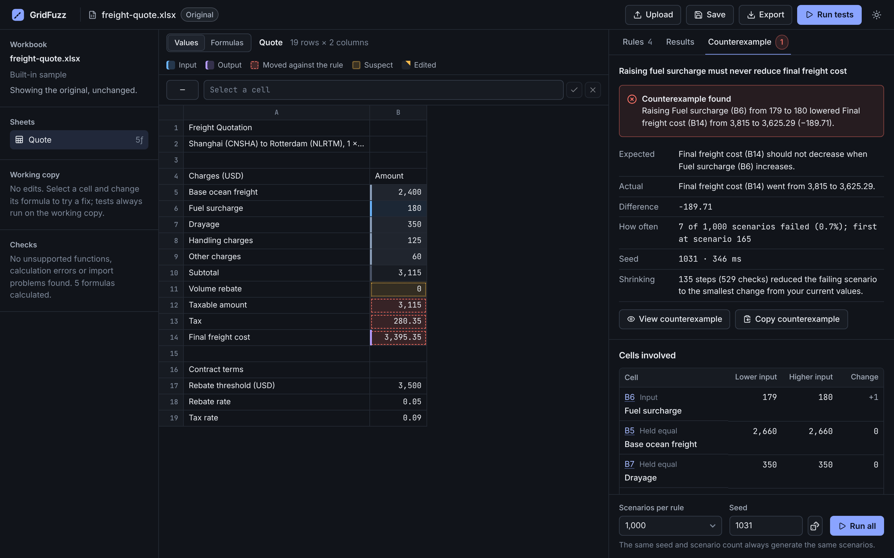

# GridFuzz

**Break your spreadsheet before your business does.**

GridFuzz stress-tests the business rules hidden inside a spreadsheet. State a rule in plain English ("increasing fuel surcharge must never reduce final freight cost"), and GridFuzz generates thousands of seeded scenarios, calculates each one, finds the violations, shrinks the first failure to a minimal counterexample, highlights the cells involved, and lets you edit a formula and rerun the identical test.

It runs entirely in your browser. There is no server, no account, no API key, and your workbook never leaves your machine.

Built for **Kiroween 2026**, Frankenstein category: a monster stitched together from three parts that were never meant to meet: a property-based tester ([fast-check](https://fast-check.dev)), a spreadsheet calculation engine ([HyperFormula](https://hyperformula.handsontable.com)) and a rule compiler.

<!-- Screenshots: see "Screenshots" below. -->


## The problem

Spreadsheets run pricing, quotes, budgets and forecasts, and almost none of them have tests. The bugs that hurt are not typos; they are rules that hold for the numbers someone tried and break at a boundary nobody tried.

The bundled Freight Quote workbook has exactly this kind of bug. The volume rebate is `=IF(B10>B17,B10*B18,0)`: once the subtotal passes 3,500, the 5% rebate applies to the **whole** subtotal instead of only the part above the threshold. A customer who is charged one dollar more can pay about $190 less. You will not find that by eyeballing the sheet at its current values. A few hundred random scenarios find it, and shrinking pins it to the exact boundary.

## Features

- **Import** `.xlsx` and `.csv` (drag and drop or file picker), sheet selection, and a preview with formulas, calculated values and what each formula reads. Wrong types, oversized files and corrupt files get specific errors.
- **Rules in plain English or by mapping cells.** A documented-pattern compiler turns a sentence into a rule, shows how each phrase matched a cell, and asks you to map a cell rather than guess. You review and confirm every rule before it runs.
- **Property-based engine.** fast-check generates scenarios; HyperFormula calculates them in a Web Worker with a private calculation instance per run. Seeds are explicit and recorded, so a run is reproducible.
- **Shrinking.** The first failure is reduced toward the simplest failing scenario, anchored to the values already in your workbook.
- **Counterexample view.** Input and output cells with before and after values, the cells that moved against the rule, and findings labelled **confirmed** (observed in calculated values) or **suggested** (a heuristic lead). "View counterexample" shows the grid with the failing values applied, on a throw-away copy.
- **Fix and retest.** Edit a formula in the working copy (the original is never modified), rerun the same rule with the same seed and scenario count, and see before and after, including a replay of the earlier counterexample.
- **Honest results.** Errors, blanks, circular references, unsupported functions and non-numeric values are reported as *inconclusive* with reasons, never counted as passes. "Passed" means "no violation found in N scenarios", not a proof.
- **Reports.** JSON report (rules, seed, counts, results, counterexamples, formula edits), copy-counterexample text, and download of the original file, byte for byte.
- **Dashboard** with real statistics only (a new user sees zeros), recent workbooks and recent activity.
- **Interface.** Dark and light themes, three-pane workspace with a toolbar, keyboard operation, reduced-motion support, responsive down to phone width.

## How it works

```
 .xlsx / .csv ─▶ importer ─▶ WorkbookModel          (original: never mutated)
                                  │  applyEdits(edits) returns a copy = working copy
 sentence ─▶ RuleCompiler ─▶ RuleDraft ─▶ Zod RuleSchema ─▶ Rule ─▶ you confirm
                                  │
 Run ─▶ testRunnerClient ─▶ Web Worker ─▶ runRule ─▶ property runner
                                              ├─ fast-check: seeded scenarios
                                              ├─ CalcEngine: HyperFormula, one instance per run
                                              ├─ census pass: count every scenario
                                              └─ shrink pass: minimal counterexample + explanation
 RuleRunResult ─▶ results · counterexample · grid highlights · JSON report
```

```
src/
  engine/        pure TypeScript, no React or DOM (runs in the worker and in Vitest)
    workbook/      WorkbookModel, A1 helpers, edits, import validation; the only SheetJS import
    calculation/   CalcEngine (HyperFormula), dependency graph, formula analysis
    expression/    safe parser and evaluator for rule expressions (no eval)
    generators/    scaled-integer arbitraries anchored at the cell's current value
    properties/    one property per rule type, the generic runner, explanations
    rule-compiler/ RuleCompiler interface, LocalRuleCompiler, cell resolver
    samples/       Freight Quote workbook and rules
  schemas/       Zod schemas for rules and test configuration
  workers/       testRunner.worker.ts
  services/      worker client, local storage, statistics, report export
  state/         one app-state hook + context, grid highlighting
  components/    Dashboard, ImportView, Workspace (grid, rules, run bar, results, counterexample)
tests/           Vitest unit and property tests
e2e/             Playwright tests (production build)
.kiro/           Kiro spec, steering, hooks and custom agent
```

Design notes worth knowing:

- **Shrinking goes toward your data.** Generated values are integer offsets from the cell's current value, so a minimal counterexample is close to what is really in the sheet.
- **Monotonic rules compare pairs** drawn both widely and from neighbouring values, because threshold bugs only show at small steps.
- **Confirmed vs suggested.** The first cell on the dependency path that moved against the rule is a confirmed fact: both values were calculated. A step-like function such as `IF` on that path is only a suggested cause.
- **Cached values in the file are never used.** Everything is recalculated by HyperFormula.

## Tech stack

TypeScript (strict), React 19, Vite, Vitest, Playwright, [fast-check](https://fast-check.dev) (property-based testing and shrinking), [HyperFormula](https://hyperformula.handsontable.com) (calculation), [SheetJS](https://sheetjs.com) `xlsx` 0.18.5 (reading .xlsx and .csv), [Zod](https://zod.dev) (rule validation), Recharts (one stacked bar chart), lucide-react (icons), Inter and JetBrains Mono (bundled via Fontsource). Styling is hand-written CSS with design tokens.

## Install, develop, test

Requires Node 20 or newer.

```bash
npm ci                # install
npm run dev           # development server (http://localhost:5173)
npm run build         # typecheck + production build into dist/
npm run preview       # serve dist/ locally (http://localhost:4173)

npm run typecheck     # strict TypeScript, no emit
npm test              # Vitest unit and property tests
npm run test:e2e      # Playwright against the production build
npm run samples       # regenerate public/samples/*.xlsx and .csv
npm run notices       # regenerate THIRD_PARTY_NOTICES.md
```

First run of the end-to-end tests: `npx playwright install chromium`. If a Chromium is already installed (for example in an offline CI image), set `PLAYWRIGHT_CHROMIUM_EXECUTABLE=/path/to/chrome` instead.

### Deploy

GridFuzz is a static site. `npm run build` produces `dist/` with relative asset URLs (`base: './'`), so it works from any static host and from a GitHub Pages project path. `.github/workflows/deploy.yml` builds and publishes to GitHub Pages on every push to `main` (enable **Settings → Pages → Source: GitHub Actions** once). `.github/workflows/ci.yml` runs typecheck, unit tests, build and the end-to-end test on every push and pull request.

## Demo walkthrough: find and fix a real bug in under three minutes

1. Open GridFuzz and choose **Open the freight quote sample**. The dashboard starts at zero; nothing is pre-filled.
2. The workspace opens with four rules. The first, *Raising fuel surcharge must never reduce final freight cost*, is selected and its input (B6) and output (B14) are marked in the grid.
3. Read the rule in the rules panel, or type your own sentence and review how it compiles.
4. Press **Run** on that rule (seed 1031, 1,000 scenarios).
5. GridFuzz reports **Counterexample found**: 7 of 1,000 scenarios failed, the first at scenario 165.
6. The counterexample is shrunk (135 steps) to the exact boundary: raising Fuel surcharge (B6) from 179 to 180 lowered Final freight cost (B14) from 3,815 to 3,625.29, because the subtotal crossed 3,500.
7. Look at the highlighted cells: B12 (Taxable amount) is **confirmed** as the first cell that moved against the rule; B11 (Volume rebate, an `IF`) is a **suggested** suspect.
8. Press **View counterexample** to see the grid with the failing values applied on a throw-away copy, and step between the lower and higher input.
9. Press the known-fix button, or type `=MAX(B10-B17,0)*B18` into B11 yourself, and rerun the same rule. It now passes: 0 of 1,000 scenarios fail, and the earlier counterexample replays as 3,815 then 3,816.04. Export the JSON report, and download the original workbook to confirm it is unchanged.

The numbers above come from the engine on every run; none of them is stored in the app.

## Supported rule patterns

The built-in compiler recognises these patterns and refuses anything else (it lists what it supports). Cell names are matched against the labels in your sheet; if a phrase does not match exactly one cell, you are asked to map it.

| Pattern | Rule type | Example sentence |
|---|---|---|
| Raising one value must not lower another | monotonic increasing | Increasing fuel surcharge must never reduce final freight cost. |
| Raising one value must not raise another | monotonic decreasing | Increasing discount must never increase the final price. |
| Never negative | non-negative | Final invoice amount must never be negative. |
| Upper limit | bounds | Discount percentage must not exceed 30%. |
| Lower limit | bounds | Margin must be at least 5%. |
| Range | bounds | Tax rate must be between 0% and 25%. |
| Equals a sum | invariant | Subtotal must equal the sum of B5:B9. |
| Equals a calculation | invariant | Tax must equal taxable amount times tax rate. |
| Compared with a calculation | invariant | Volume rebate must not exceed B10 * 10%. |
| If … then … | conditional | If subtotal is greater than 3500 then volume rebate must be greater than 0. |

You can also build any of the six rule types by hand with the rule form ("Use selected" fills a cell from the grid).

Rule expressions support `+ - * / ^`, percentages, cell references (`B10`, `Quote!B10`) and the functions `SUM`, `MIN`, `MAX`, `AVERAGE`, `ABS`, `ROUND`. They are parsed into an AST and interpreted; nothing is passed to `eval`.

### Supported spreadsheet functions

Workbook formulas are calculated by HyperFormula 3.5.0, which registers 423 functions (math, logical, text, date, lookup, financial and more; `SUM`, `IF`, `VLOOKUP`, `XLOOKUP`, `INDEX`, `MATCH`, `SUMIFS`, `IFERROR`, `ROUND`, `PMT`, `TEXT` and `FILTER` among them). A function HyperFormula does not implement (for example `LET` and `LAMBDA`) evaluates to `#NAME?`; GridFuzz warns about it on import and reports rules that depend on it as inconclusive. Volatile functions (`RAND`, `RANDBETWEEN`, `NOW`, `TODAY`, `OFFSET`, `INDIRECT`) produce a warning because tests that use them may not be reproducible.

## Limitations

- **Evidence, not proof.** "No violation found in N scenarios" means exactly that. More scenarios and different seeds raise confidence; they never prove a rule. In the sample, 1,000 scenarios found the bug for all 40 seeds tried, 300 for 38 of 40, and 100 for only 26 of 40.
- **Local pattern compiler only.** There is no AI interpretation. The `RuleCompiler` interface leaves room for one behind a server-side proxy; no API key may ever ship in the client.
- **Size limits.** 5 MB per file and 200,000 filled cells, because everything runs in the browser.
- **Numbers only.** Rules vary and check numeric cells. Text, date and boolean inputs are not generated.
- **Formula coverage is HyperFormula's.** Macros, external links, pivot tables and workbook charts are not supported. Multi-sheet workbooks import and every sheet is calculated; the sentence compiler resolves labels across sheets (preferring the one you have open) and accepts `Sheet!B5` references. The sample and the automated tests exercise a single sheet, so cross-sheet rules are the least-tested path.
- **Shrinking is a search, not a guarantee of the global minimum.** It reports the steps it took and whether the result reproduces.
- **Files are kept in memory only.** Reopening a recent workbook asks for the file again (the built-in sample reloads itself). Rules, settings and your formula edits are remembered in `localStorage`.
- **Large bundle.** The calculation engine is bundled twice (page and worker). The first load downloads roughly 3 MB before compression (the page, the worker and the lazily loaded spreadsheet reader); the browser caches it afterwards.
- **Known advisory in the spreadsheet reader.** `npm audit` reports two issues in SheetJS `xlsx` 0.18.5, the last version published to npm (prototype pollution and a regular-expression denial of service when parsing a crafted file). SheetJS ships fixed releases only from its own CDN. Until you upgrade, open only workbooks you trust: a hostile file could stall or tamper with the page that opens it, and nothing more (there is no server, account or stored secret to reach). To upgrade, run `npm install https://cdn.sheetjs.com/xlsx-0.20.3/xlsx-0.20.3.tgz` (or the current release listed at https://cdn.sheetjs.com), then `npm test && npm run test:e2e` and `npm run notices`. Only `src/engine/workbook/sheetjsAdapter.ts` imports the library.
- **Licence.** HyperFormula is GPL-3.0, so GridFuzz is GPL-3.0-only.

## Privacy and security

- Workbooks are parsed, calculated and tested in your browser (the heavy work runs in a Web Worker). Nothing is uploaded; the end-to-end suite asserts that no request leaves the page's own origin.
- `localStorage` (keys prefixed `gridfuzz.`) holds statistics, recent workbook names, activity, theme, and per-workbook rules, settings and formula edits. It never holds workbook contents. **Clear local data** on the dashboard removes all of it.
- Rule expressions and edited formulas are parsed by a hand-written parser or by HyperFormula; there is no `eval`, no `new Function`, and no HTML injection from cell content (everything is rendered as text by React).
- There is no API key, token or secret in this repository or in the build.
- Open only workbooks you trust until SheetJS is upgraded (see Limitations).

## Built with Kiro

The `.kiro/` folder is part of the project, and the app was specified before it was built.

- **Spec-driven development.** `.kiro/specs/gridfuzz/` holds `requirements.md` (user stories and EARS acceptance criteria, numbered R1 to R10), `design.md` (architecture, data models, decisions, error handling, test strategy) and `tasks.md` (an implementation plan that cites the requirements it satisfies). `tasks.md` cites the requirement numbers each task satisfies.
- **Steering.** `.kiro/steering/product.md` (always included) holds the non-negotiable product rules: no faked results, honest wording about certainty, inconclusive is its own outcome, original never modified. `architecture.md` and `testing.md` load when you work on source or tests.
- **Hooks** (`.kiro/hooks/*.json`, v1 format): run the unit tests after the agent saves engine, schema or test files; typecheck after TypeScript edits; keep the README pattern table and requirements in sync with the compiler (an agent hook); typecheck and test when the agent stops.
- **Custom agent** (`.kiro/agents/test-reviewer.json`): a read-only reviewer that can read the repo and run `npm test`, and nothing else (a deny rule blocks every other shell command). Use it to audit coverage against the requirements.

The Kiro files follow the formats in Kiro's documentation but were written outside Kiro; if your Kiro version reports a schema difference, the file names and fields are the place to look first. No MCP servers are configured.

## Screenshots

Generate fresh screenshots into `docs/screenshots/` with:

```bash
npm run build && npm run preview -- --port 4173 &   # serve the production build
npm run screenshots                                 # needs Playwright's Chromium (see above)
```

The script (`scripts/capture-screenshots.mjs`) opens the sample, runs the flagship rule with the default seed and captures `01-dashboard.png`, `02-workspace.png`, `03-counterexample.png`, `04-fix-verified.png` and `05-light-theme.png`. Set `GRIDFUZZ_URL` if the app is served elsewhere.

## Licence and acknowledgements

GridFuzz is licensed under the **GNU General Public License v3.0 only** (see [LICENSE](LICENSE)). This follows from using [HyperFormula](https://hyperformula.handsontable.com) under its GPL-3.0 licence. Third-party licences are listed in [THIRD_PARTY_NOTICES.md](THIRD_PARTY_NOTICES.md).

Thanks to the authors of fast-check (property-based testing and shrinking), HyperFormula (the calculation engine), SheetJS, Zod, React, Vite, Vitest, Playwright, Recharts and lucide, to Fontsource for the bundled fonts, and to the Kiro team for the hackathon.
